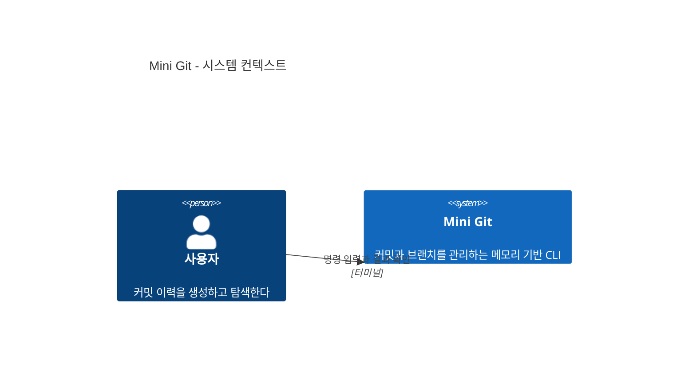
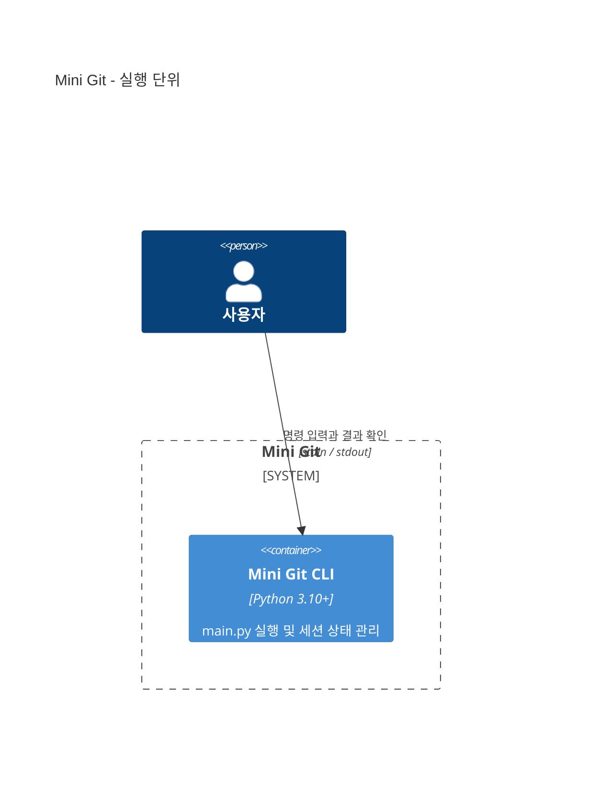
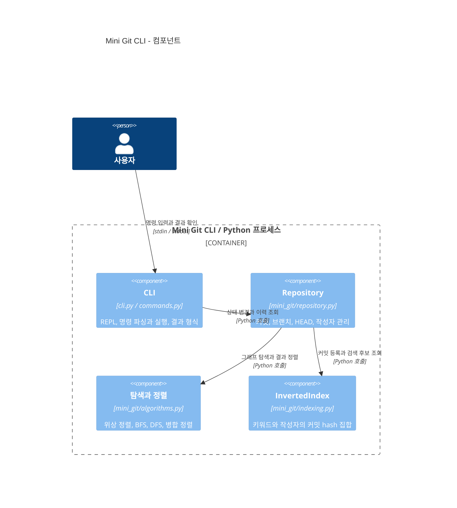
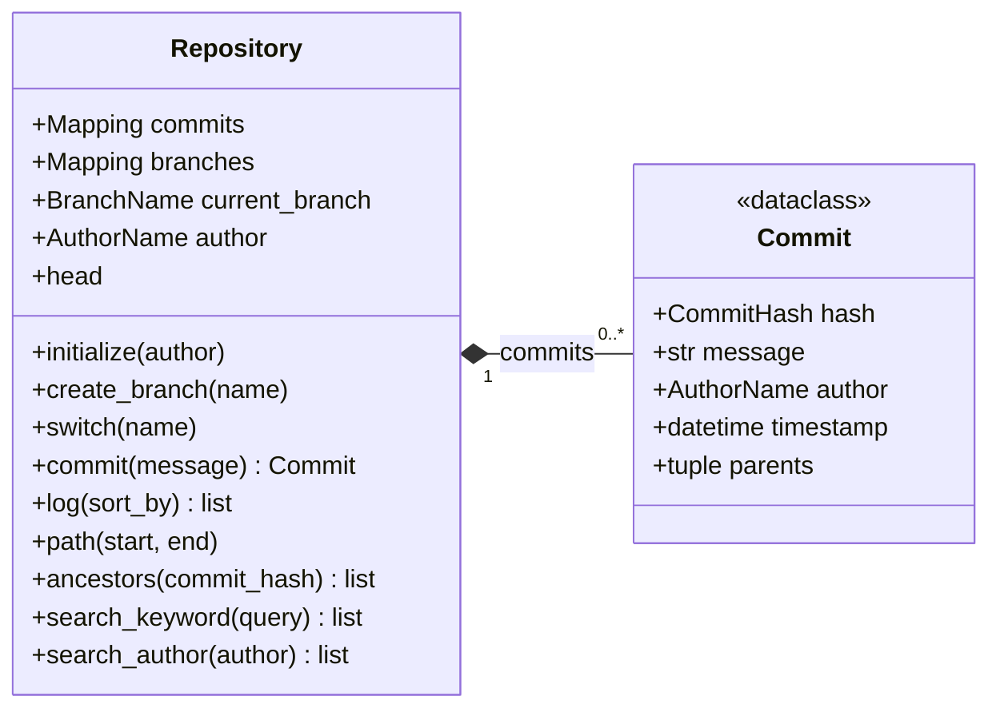

# Mini Git 학습 정리

## 1. 커밋, 브랜치, HEAD

- 커밋은 `hash`, `message`, `author`, `timestamp`, `parents`를 가진 노드다.
- `dict[CommitHash, Commit]`으로 커밋을 조회한다. 해시맵 조회는 평균 O(1)이다.
- 브랜치는 마지막 커밋의 hash를 저장한다. HEAD는 현재 브랜치가 가리키는 커밋이다.
- 초기화 후 작성자와 브랜치 상태가 생긴다. 커밋이 없는 브랜치의 HEAD는 `None`이다.
- 새 커밋의 부모는 생성 당시 HEAD다. 커밋 후에는 현재 브랜치만 새 커밋을 가리킨다.
- 식별자는 증가 카운터를 16진수로 표현한다. 메시지가 같아도 중복되지 않는다.

`CommitHash`, `BranchName`, `AuthorName`은 문자열의 역할을 구분한다.
`PATH`는 두 해시를 담은 `PathCommand`로 파싱하고, 저장소에서 두 커밋을 조회한 뒤 탐색한다.
정적 타입 검사는 인자의 역할을 확인하고, 커밋 존재 여부는 저장소가 실행 중 확인한다.

## 2. DAG와 위상 정렬

커밋의 부모는 이미 존재하는 커밋이며, 생성 후 부모 연결은 바뀌지 않는다.
따라서 새 노드를 추가해도 순환이 생기지 않는 방향성 비순환 그래프(DAG)가 된다.
필수 커밋 명령은 부모가 0개 또는 1개인 노드를 만들며, 탐색 함수는 여러 부모도 처리한다.

### Kahn 알고리즘의 동작

Kahn 알고리즘은 **먼저 처리해야 할 노드가 없는 노드부터 출력하는 위상 정렬**이다.
이 프로젝트에서는 모든 부모가 출력된 커밋을 처리할 수 있다.
저장된 `자식 -> 부모 목록`으로부터 `부모 -> 자식 목록`을 만들고,
각 커밋의 **진입 차수**를 아직 출력하지 않은 부모 수로 관리한다.

1. 각 커밋의 부모 수를 세고, 부모가 없는 커밋을 큐에 넣는다.
2. 큐의 앞에서 커밋 하나를 꺼내 결과에 추가한다.
3. 그 커밋의 각 자식에서 남은 부모 수를 1씩 줄인다.
4. 남은 부모 수가 0이 된 자식을 큐에 넣는다.
5. 큐가 빌 때까지 반복하고, 처리한 커밋 수가 전체 수와 같은지 확인한다.

예를 들어 B·C의 부모가 A이고, D의 부모가 B·C인 그래프를 탐색하면 다음과 같다.
이 예시는 탐색 함수의 다중 부모 처리를 설명하기 위한 입력이다.

| 처리한 노드 | 남은 부모 수 (A, B, C, D) | 다음 큐 |
| --- | --- | --- |
| 시작 | (0, 1, 1, 2) | A |
| A | (0, 0, 0, 2) | B, C |
| B | (0, 0, 0, 1) | C |
| C | (0, 0, 0, 0) | D |
| D | (0, 0, 0, 0) | 비어 있음 |

결과는 `A, B, C, D`다. D는 B와 C가 모두 처리된 뒤에만 출력된다.
B와 C처럼 서로 의존하지 않는 노드의 순서는 달라도 유효하다.
현재 구현은 큐에 들어온 순서를 따른다.

큐가 비었는데 처리하지 못한 노드가 남으면 사이클이 있다는 뜻이다.
`topological_order()`는 이 경우 오류를 발생시킨다.
각 노드와 간선을 한 번씩 처리하므로 시간복잡도는 O(V + E)다.
큐는 앞에서 꺼내는 연산이 O(1)인 `deque`를 사용한다.

기본 `LOG`는 이 순서로 전체 브랜치의 커밋을 출력한다.
날짜·작성자 정렬 옵션을 주면 위상 정렬 결과를 해당 기준의 오름차순으로 다시 정렬한다.

## 3. BFS와 DFS

- **최단 경로:** 부모 연결을 무방향으로 바꾼 뒤 목적지에서 BFS로 거리를 계산한다.
  출발지부터 거리가 1씩 줄어드는 이웃만 선택하면 최단 경로가 된다.
  후보가 여러 개면 다음 hash와 `->`를 합친 문자열을 비교해 전체 경로의 사전순을 결정한다.
- **모든 조상:** 부모 방향으로만 DFS를 수행한다. 방문 집합으로 중복을 막고 자신은 제외한다.
  재귀 대신 명시적인 스택을 사용해 긴 이력에서도 재귀 깊이 제한을 피한다.

## 4. 안정 병합 정렬

### 병합 정렬의 과정

병합 정렬은 목록을 나누고, 나눈 목록을 정렬한 뒤 합치는 알고리즘이다.

1. 원소가 0개 또는 1개가 될 때까지 목록을 반으로 나눈다.
2. 정렬된 왼쪽·오른쪽 목록의 앞 원소를 비교해 작은 것을 결과에 추가한다.
3. 한쪽 목록을 모두 사용하면 다른 쪽의 남은 원소를 순서대로 붙인다.

```text
[4, 1, 3, 2]
→ [4, 1] / [3, 2]
→ [4] / [1] / [3] / [2]
→ [1, 4] / [2, 3]
→ [1, 2, 3, 4]
```

### 안정 정렬의 의미

**안정(stable)**은 비교 키가 같은 원소들의 입력 순서를 유지한다는 뜻이다.
아래에서 첫 번째 값만 정렬 키로 사용하고, A·B·C·D는 원소를 구분하는 표시라고 하자.

```text
입력: [(2, A), (1, B), (2, C), (1, D)]
결과: [(1, B), (1, D), (2, A), (2, C)]
```

키가 1인 B·D와 키가 2인 A·C의 상대 순서가 각각 유지된다.
`merge_sort()`는 두 키가 같으면 `<=` 조건으로 **왼쪽 원소를 먼저 선택**한다.
왼쪽 목록은 원래 입력에서도 앞에 있었으므로, 각 병합 단계에서 이 규칙을 지키면 안정성이 유지된다.

정렬 키를 함수로 받기 때문에 날짜와 작성자 정렬에 같은 함수를 사용할 수 있다.
키가 같은 커밋끼리는 입력으로 받은 기본 로그의 위상 순서를 유지한다.
서로 다른 키를 가진 커밋은 지정한 정렬 기준을 따른다.

분할 깊이가 O(log N)이고 각 깊이의 병합 작업이 O(N)이므로 평균·최악 시간복잡도는 O(N log N)이다.
현재 구현은 입력을 직접 바꾸지 않고 새 목록을 반환하며, 추가 공간은 O(N)이다.

## 5. 역색인

### 무엇을 저장하는가

역색인은 **검색할 값에서 그 값이 등장하는 커밋 hash 집합을 찾는 자료구조**다.
`commits`가 `hash -> 커밋 정보`를 저장한다면, 역색인은 `토큰 또는 작성자 -> hash 집합`을 저장한다.

예를 들어 역색인에 다음 커밋 정보를 등록했다고 하자. h1·h2·h3는 hash를 줄여 쓴 값이다.

| hash | 작성자 | 메시지 |
| --- | --- | --- |
| h1 | Alice | Add LOGIN login |
| h2 | Bob | Add payment |
| h3 | Alice | Fix login |

메시지를 공백으로 나누고 소문자로 정규화하면 다음 인덱스가 만들어진다.

| 인덱스 | 키 | hash 집합 |
| --- | --- | --- |
| 키워드 | add | {h1, h2} |
| 키워드 | login | {h1, h3} |
| 키워드 | payment | {h2} |
| 키워드 | fix | {h3} |
| 작성자 | Alice | {h1, h3} |
| 작성자 | Bob | {h2} |

### 커밋 생성과 검색 과정

`Repository.commit()`은 커밋과 현재 브랜치를 갱신한 뒤, 반환 전에 `InvertedIndex.add()`를 호출한다.
이때 `message.lower().split()`의 결과를 집합으로 만들어 중복 토큰을 제거한다.
h1의 `LOGIN login`은 하나의 `login` 키에 h1을 한 번만 등록한다.
작성자는 원문 그대로 등록하므로 공백과 대소문자도 이름의 일부다.

1. `SEARCH LOGIN`은 검색어를 `login`으로 정규화하고 `{h1, h3}`을 조회한다.
2. `SEARCH "ADD login"`은 `{h1, h2}`와 `{h1, h3}`의 교집합인 `{h1}`을 구한다.
3. `SEARCH --author=Alice`는 작성자 인덱스에서 `{h1, h3}`을 조회한다.
4. 저장소는 후보 hash에 해당하는 커밋만 가져와 hash 오름차순으로 정렬한다.

`find_keyword()`는 첫 후보 집합을 복사한 뒤 교집합을 구해 원본 인덱스를 변경하지 않는다.
일치하는 키가 없으면 빈 집합을 반환하고, CLI는 `No commits found`를 출력한다.
검색은 토큰의 정확한 일치 기준이므로 `log`는 `login`과 일치하지 않으며, `login!`도 별도 토큰이다.
작성자 `alice`는 `Alice`와 일치하지 않는다.

### 비용과 관리할 점

- 딕셔너리에서 후보 집합을 찾는 연산은 평균 O(1)이지만, K개 결과를 복사·조회·정렬하는 비용은 별도로 든다.
  현재 단일 토큰·작성자 검색은 평균 O(1 + K log K)이며, 여러 토큰에는 교집합 계산 비용이 추가된다.
- 커밋 생성 시 메시지 토큰 수에 비례하는 인덱스 갱신 비용과 토큰·커밋 연결을 저장할 메모리가 필요하다.
- 검색 결과가 전체 커밋에 가까우면 조회 범위를 줄이는 이점이 작아진다.
  커밋 수정·삭제 기능을 추가한다면 기존 인덱스 항목도 함께 갱신해야 한다.

## 6. 시간복잡도

V는 전체 커밋 수, E는 부모 연결 수, A·Eₐ는 도달 가능한 조상 수와 그 연결 수다.
W는 메시지 토큰 수, K는 검색 결과 수다. 해시·문자열 비교 비용은 고정 크기로 가정한다.

| 연산 | 시간복잡도 | 근거 |
| --- | --- | --- |
| 브랜치 생성·전환 | 평균 O(1) | 브랜치 딕셔너리 조회·갱신 |
| 커밋 생성 | 평균 O(W) | 노드 등록과 토큰 인덱스 갱신 |
| 기본 로그 | O(V + E) | 위상 정렬 |
| 정렬 옵션 로그 | O(V + E + V log V) | 위상 정렬 후 병합 정렬 |
| 최단 경로 | O(V + E) | 무방향 그래프 구성, BFS와 경로 선택 |
| 모든 조상 | O(A + Eₐ) | 도달 가능한 부모만 DFS |
| 단일 토큰·작성자 검색 | 평균 O(1 + K log K) | 후보 조회·복사 후 결과 정렬 |

여러 토큰 검색에는 각 후보 집합의 교집합 계산 비용이 추가된다.

## 7. 환경과 검증

uv는 `.venv`와 의존성을 관리하며, `uv.lock`으로 버전을 고정한다.
Just는 환경 준비·실행·검증 명령을 제공하고 실행에는 `--locked`를 적용한다.
`just check`는 잠금 파일, mypy 타입 검사, pytest를 실행하며 라인 80%, 분기 70% 커버리지를 각각 확인한다.
분기된 이력, 다중 부모, 동률 경로, 입력 오류 후 복구와 역색인 조회를 테스트한다.

## 8. 구현 구조: C4 모델

시스템에서 코드까지 네 수준으로 확대해 본다. C4의 컨테이너는 애플리케이션이나 데이터 저장소를 뜻한다.
이 프로젝트의 실행 컨테이너는 상태를 메모리에 보관하는 하나의 Python 프로세스다. [C4 컨테이너 정의](https://c4model.com/diagrams/container)

### C1. 시스템 컨텍스트

사용자는 터미널에서 Mini Git 명령을 실행하고 결과를 확인한다.



### C2. 컨테이너

`just run`은 `uv run --locked python main.py`로 CLI를 실행한다.
커밋·브랜치·역색인은 이 프로세스 안에 유지되며 종료 시 사라진다.



### C3. 컴포넌트

CLI는 명령과 출력을 처리하고, 저장소는 상태를 관리하며 알고리즘과 역색인을 호출한다.
화살표는 사용·호출 방향이다.



### C4. 코드: 저장소와 커밋

`repository.py`의 핵심 클래스를 나타낸다. `Commit`은 불변 dataclass이고,
`parents`에는 부모의 hash를 저장한다. `head`는 현재 브랜치가 가리키는 커밋을 조회하는 프로퍼티다.
[C4의 코드 수준](https://c4model.com/diagrams/code)은 Mermaid 클래스 다이어그램으로 표현한다.



문법 참고: [Mermaid C4 다이어그램](https://mermaid.js.org/syntax/c4.html).
